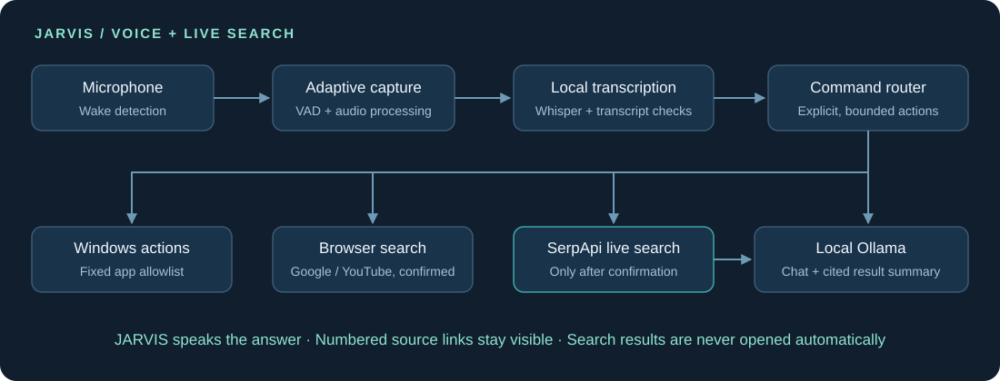

# Project JARVIS

**A local AI voice assistant for Windows, built around Hindi, English, and Hinglish commands.**

JARVIS connects speech recognition, local language-model conversations, spoken replies, and a small set of Windows actions. The project explores a practical question: how can a voice assistant remain useful on a CPU laptop while keeping its computer controls predictable?

**Status:** working prototype, version 4.1 · Windows · CPU inference · active development

## What it does

- Activates with “Hey Jarvis,” with a short local speech-recognition fallback for “Jarvis.”
- Captures commands with pre-roll, voice activity detection, room-noise calibration, and quiet-input boosting.
- Uses faster-whisper for English/Hindi transcription, including language retries and rejection of obvious nonsense or repeated text.
- Runs conversations through Ollama on the same computer and replies using the installed Windows voice.
- Searches current Google results through SerpApi after the user confirms, summarizes returned excerpts locally with Ollama, and prints numbered source links.
- Opens Chrome, Notepad, Calculator, File Explorer, Settings, the project folder, Google, or YouTube through fixed actions.
- Requests spoken confirmation before sending a search query to SerpApi, Google, or YouTube.
- Offers microphone selection, configuration display, an opt-in microphone test, and wake diagnostics.

## How it works



**Stack:** Python · SerpApi Google Search API · requests · faster-whisper · openWakeWord / ONNX Runtime · Ollama · WebRTC VAD · sounddevice · NumPy · SciPy · pyttsx3

The default speech model is Whisper `small`, using CPU `int8` inference. The main speech loader can fall back to `base`; the short wake fallback also uses `base`. Conversations use `qwen3.5:2b` through `http://127.0.0.1:11434/api/chat`.

## Run locally

The development environment uses **Windows 11 and Python 3.11**. A microphone and an installed Windows speech voice are required. Other operating systems are not supported by this implementation.

1. Install [Python](https://www.python.org/downloads/windows/) and [Ollama for Windows](https://ollama.com/download/windows).
2. Open PowerShell in this project folder and prepare the environment:

   ```powershell
   py -3.11 -m venv .venv
   .\.venv\Scripts\python.exe -m pip install -r requirements.txt
   .\.venv\Scripts\python.exe -c "from openwakeword.utils import download_models; download_models(model_names=['hey_jarvis'])"
   ollama pull qwen3.5:2b
   ```

3. Keep Ollama running. Review the selected microphone without recording:

   ```powershell
   .\.venv\Scripts\python.exe jarvis.py --show-config
   ```

4. Double-click `Start_JARVIS.cmd`, or run:

   ```powershell
   .\.venv\Scripts\python.exe jarvis.py
   ```

The first speech-model load may download Whisper models. Initial dependency and model setup requires internet access. Requirements list the imported libraries and selected ONNX runtime without version pins; a clean installation has not yet been validated as a reproducible release.

### Run the live-web demo without a microphone

1. Create a SerpApi key from your account and copy the local example file:

   ```powershell
   Copy-Item .env.example .env
   notepad .env
   ```

2. Replace `your_serpapi_key_here` with your key. The real `.env` file is ignored by Git. Keep the key private and do not paste it into source code, screenshots, or a public repository.
3. Keep Ollama running with the `qwen3.5:2b` model, then start the no-microphone demo:

   ```powershell
   .\.venv\Scripts\python.exe jarvis.py --search-demo
   ```

Type a question in English or Hindi. JARVIS asks for confirmation before it sends the query to SerpApi and its search provider. It shows the result links, asks the local Ollama model to summarize only the returned excerpts, and speaks the answer. The live API path needs a valid key and a search credit; no search key is included in this project.

Hindi text is always printed. Spoken Hindi uses a Hindi Windows voice if one is installed; otherwise JARVIS falls back to the system's default voice.

The request follows SerpApi's documented [Google Search API](https://serpapi.com/search-api) JSON endpoint. See its [Python integration guide](https://serpapi.com/integrations/python) for the official SDK alternative.

### What the demo makes visible

- JARVIS repeats the query and waits for a clear yes before any search request is sent.
- The Google search is localized to India, with Hindi or English response language.
- The screen shows the result excerpts and numbered source links, so viewers can compare the answer with its evidence.
- JARVIS never opens result pages automatically. Search text is sent to SerpApi; only result excerpts go to the local Ollama model for summarizing.
- API keys stay in an ignored local `.env` file. Errors are written without exposing the key-bearing request URL.

The same search works by voice in normal JARVIS mode. Say **“Search the web for [question]”** or **“Web par search karo [question].”** JARVIS repeats what it plans to search and waits for a separate spoken “yes” before making the request. A request in Hindi (including a Hindi response cue) gets Hindi output; otherwise it defaults to English.

Say **“Jarvis”** or **“Hey Jarvis,”** wait for the activation beep, then speak your command. Stop the app with `Ctrl+C` or the voice command “stop Jarvis.” Keep the terminal open while it runs.

### Example commands

| Say after activation | Behavior |
| --- | --- |
| “Open Calculator” | Launches Calculator. |
| “Notepad kholo” | Launches Notepad. |
| “What time is it?” | Speaks the current local time. |
| “Search the web for the SerpApi Python SDK in Hindi” | Asks before calling SerpApi, then summarizes results locally and shows the source links. |
| “Search for Python documentation” | Asks before opening a Google search in the browser. |
| “Open Chrome, then open YouTube, then find me a video of BMW F450GS” | Opens Chrome/YouTube and asks before submitting the video search. |

For a pending search, wake JARVIS again, wait for the beep, then say **“yes”** or **“no.”** Confirmation expires after 30 seconds; a new command clears the pending request. The YouTube action opens search results; it does not choose or play a video.

### Diagnostics and tuning

```powershell
# List inputs without recording
.\.venv\Scripts\python.exe jarvis.py --list-devices

# Inspect a selected input without recording
.\.venv\Scripts\python.exe jarvis.py --mic "Microphone Array" --show-config

# Explicit six-second in-memory level test; waits for Enter first
.\.venv\Scripts\python.exe jarvis.py --mic-test

# Print wake scores and local speech candidates while listening
.\.venv\Scripts\python.exe jarvis.py --wake-debug

# Try the smaller model or force one transcription language
.\.venv\Scripts\python.exe jarvis.py --model base --language en
```

`--mic` accepts a device number or part of its name. The `JARVIS_MIC_DEVICE`, `JARVIS_WHISPER_MODEL`, and `JARVIS_LANGUAGE` environment variables provide defaults. Microphone selection prefers WASAPI, captures at 48 kHz when supported, and resamples locally to 16 kHz. Command timing and thresholds are constants near the top of `jarvis.py`.

## Data and action boundaries

Speech processing and Ollama conversation requests run locally after model setup. Audio is held in memory; this script does not create recordings. It listens while running, and the local wake fallback can briefly transcribe detected background speech. Normal operation prints command transcripts and replies; explicit wake debug mode can also print background speech candidates.

The live-web feature sends the confirmed search query to SerpApi and its search provider. Result excerpts are then passed to the local Ollama model for a short answer; the source links remain visible in the terminal and are not opened automatically. Browser searches send the confirmed query directly to Google or YouTube. Opening their homepages also contacts those websites. The language model does not execute computer actions: the Python router handles the fixed allowlist. Deletion, arbitrary terminal commands, software installation, shutdown/restart, and sending messages are outside the supported actions.

## Verification and current limits

Previous development checks covered Python compilation, model loading, microphone selection, resampling, transcript guards, and simulated command routing/confirmation. Live development sessions observed successful wake activation. The new SerpApi path has not been run with a real API key, and the latest combined spoken Chrome/YouTube sequence has not been verified end to end.

Recognition and responsiveness still vary with microphone placement, background noise, accent, language mixing, and CPU load. There is no formal accuracy or latency benchmark, general desktop navigation, screenshot understanding, or packaged installer. The project is a prototype for local experimentation.

## Project files

```text
jarvis.py               Voice pipeline, command router, and local conversation loop
serpapi_live_search.py  Confirmed SerpApi request, source extraction, local summary
Start_JARVIS.cmd        Windows launcher; forwards optional arguments
requirements.txt       Python dependencies
.env.example           Local SerpApi key template; copy to ignored .env
.gitignore             Excludes local environments, keys, models, recordings, logs
```

No model weights, audio recordings, local environments, or development backups are included. An optional `jarvis_wake.onnx` can be loaded from this folder if a user supplies a suitable model; no custom model is distributed here.

## Upstream projects and model terms

JARVIS builds on [faster-whisper](https://github.com/SYSTRAN/faster-whisper), [openWakeWord](https://github.com/dscripka/openWakeWord), [Ollama](https://github.com/ollama/ollama), and [Qwen3.5](https://ollama.com/library/qwen3.5:2b), alongside the libraries in `requirements.txt`.

Model weights retain their upstream terms. In particular, openWakeWord documents its bundled pretrained wake models under **CC BY-NC-SA 4.0**, separately from its Apache 2.0 library code; see the [upstream license section](https://github.com/dscripka/openWakeWord#license). This repository does not bundle those weights.
